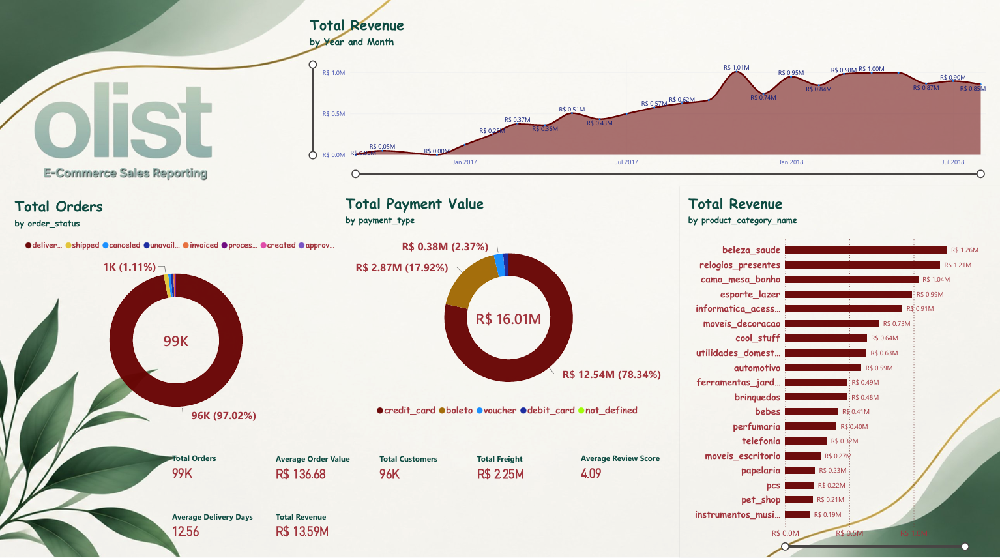
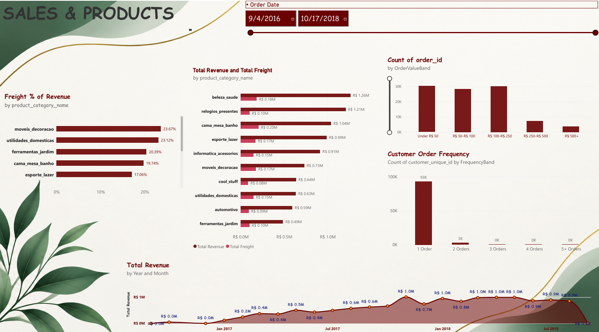

# Olist E-Commerce Business Analytics

An end-to-end business analytics project using PostgreSQL, SQL, Python, and Power BI to analyze Brazilian e-commerce sales, customer behavior, product performance, payments, and delivery operations.

## Project Overview

This project transforms the Olist public e-commerce dataset into a relational PostgreSQL database, analyzes business performance using SQL, and presents key findings through an interactive Power BI dashboard.

The goal is to demonstrate practical skills in data preparation, relational database analysis, business intelligence, KPI reporting, and data storytelling.

## Dashboard Preview

### Executive Overview

### Sales & Products

## Technology Stack

- **PostgreSQL** — relational database and analytical queries
- **SQL** — joins, aggregations, CTEs, window functions, customer analysis, and business KPIs
- **Power BI** — interactive dashboards, measures, charts, and date filtering
- **Python** — supporting data analysis and automation, where applicable
- **Git and GitHub** — version control and project documentation

## Business Questions

This project explores questions such as:

- How does revenue change over time?
- Which product categories generate the most revenue?
- Which payment methods account for the largest payment value?
- How do freight costs vary across categories and order values?
- How frequently do customers make repeat purchases?
- How do order statuses and delivery times affect operations?
- Which Brazilian states generate the most orders and sales?

## Key Findings

The following figures come from the SQL analysis and should be verified against the final Power BI report.

| Metric | Result |
|---|---:|
| Total orders | 99,441 |
| Total product revenue | R$13,591,643.70 |
| Total freight | R$2,251,909.54 |
| Total payment value | R$16,008,872.12 |
| Average review score | 4.09 / 5 |
| Average delivery time | 12.56 days |
| Delivered orders in the status analysis | 96,478 |

**Metric definitions matter:** product revenue, payment value, and freight are different measures. Payment totals may differ from product revenue because payments can include freight and other payment adjustments. Delivery metrics may exclude orders with missing timestamps.

## SQL Analysis

The SQL analysis covers:

- Database tables and relational integrity
- Data validation and indexing
- Core business KPIs
- Monthly revenue trends and month-over-month growth
- Customer repeat-purchase behavior
- Product and category performance
- Order status and delivery performance
- Payment method analysis
- Customer segmentation and RFM analysis
- Basket size and order-value distribution
- Seller and geographic performance

See the `sql/` directory for the individual query scripts.

## Power BI Dashboards

### Page 1 — Executive Overview

Provides a high-level view of order volume, revenue, average order value, freight, customer metrics, review scores, delivery performance, revenue trends, product categories, order status, and payment methods.

### Page 2 — Sales & Products

Explores revenue trends, category revenue, freight as a percentage of revenue, revenue-versus-freight comparisons, order-value bands, and customer order frequency.

The report uses Brazilian Real (BRL) for monetary reporting and date slicers for interactive analysis.

## Dataset

**Source:** Olist Brazilian E-Commerce Public Dataset

Dataset source: https://www.kaggle.com/datasets/olistbr/brazilian-ecommerce

The dataset contains anonymized e-commerce orders, customers, sellers, products, payments, reviews, and geographic information.

Download the original dataset from its source and place the CSV files in the appropriate local data directory before running the import scripts.

## How to Reproduce the Analysis

1. Install PostgreSQL.
2. Download the original dataset from the source linked above.
3. Create the project database.
4. Run the SQL schema and import scripts in the documented order.
5. Run the validation and analysis queries in `sql/`.
6. Open `powerbi/SQL_Business_Analytics.pbix` in Power BI Desktop.
7. Configure the PostgreSQL connection if refreshing the report.

See the project scripts for exact database names, table definitions, and import instructions. Local file paths and database connection settings may need to be adjusted for your environment.

## Limitations

- The dataset represents historical transactions rather than live business activity.
- Some metrics depend on the population of orders and the handling of missing timestamps.
- Repeat-customer calculations depend on the definition of a unique customer.
- The final month may represent a partial period and should be interpreted carefully.
- Results may vary when filters, date ranges, or metric definitions differ.

## Author

**Awais Khan**

Data Analytics | SQL | PostgreSQL | Power BI | Python

GitHub: https://github.com/awaiskhanai

LinkedIn: Add your LinkedIn profile URL here.

---

This project was developed for learning and portfolio demonstration using a public e-commerce dataset.